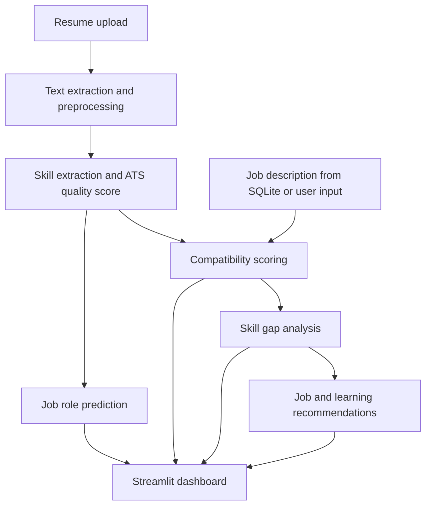

# AI-Powered Resume Analysis and Job Recommendation System

**Machine Learning [CSE_3125] Project**  
**Faculty guide:** Shreya Banerjee  
**Team members:** Tejaswini Singh (245805418) and Shriya Shet (245805454)

## Overview

Manual resume screening takes time, while keyword-based applicant tracking systems can miss relevant skills expressed using different terms. Job seekers also need clearer feedback on suitable roles and the skills they should develop.

This project is a Streamlit application that extracts information from resumes, predicts suitable job roles, compares a candidate with job requirements, and presents skill gaps and learning suggestions. It also provides a batch screening view for recruiters.

## Features

- **Resume parsing:** Extracts text from PDF, DOCX, and TXT files, then identifies contact details and resume sections.
- **ATS quality assessment:** Scores action verbs, quantifiable results, section completeness, skill density, and content length.
- **Skill extraction:** Matches resume content against a categorized skill taxonomy with aliases.
- **Job role prediction:** Compares Logistic Regression, Support Vector Machine, Random Forest, and XGBoost classifiers and shows the top predicted roles.
- **Explainable job matching:** Combines core skill overlap (45%), semantic similarity (35%), and TF-IDF similarity (20%).
- **Skill gap analysis:** Separates matched and missing core and preferred skills, with a gap severity rating.
- **Recommendations:** Ranks suitable jobs and suggests learning resources for missing skills.
- **Batch screening:** Compares multiple applicants for a selected role in a recruiter leaderboard.

## System workflow



The compatibility score uses:

```text
Overall score = 0.45 × core skill match
              + 0.35 × semantic similarity
              + 0.20 × TF-IDF cosine similarity
```

## Technology stack

| Area | Technology | Use |
| --- | --- | --- |
| Language | Python 3.11 | Application and model code |
| Interface | Streamlit | Interactive dashboard |
| PDF and DOCX parsing | PyMuPDF (`fitz`), `python-docx` | Resume text extraction |
| Text processing | NLTK, regular expressions | Cleaning, extraction, and ATS checks |
| Classification | scikit-learn, XGBoost | Job role prediction and model comparison |
| Semantic similarity | `sentence-transformers` (`all-MiniLM-L6-v2`) | Contextual resume and job comparison |
| Lexical similarity | TF-IDF, cosine similarity | Term-based comparison |
| Storage | SQLite, JSON, CSV | Jobs, resources, taxonomy, and training data |
| Charts | Plotly | Scores and model comparisons |

## Project structure

```text
ai-resume-analyzer/
├── app.py                    # Streamlit application
├── train_models.py           # Model training and evaluation
├── requirements.txt          # Python dependencies
├── run.bat                   # Windows launcher
├── run.ps1                   # PowerShell launcher
├── data/
│   ├── skills_dataset.json
│   ├── job_descriptions.json
│   ├── learning_resources.json
│   ├── resume_training_data.csv
│   └── resumes_database.db
├── models/
│   ├── job_role_classifier.pkl
│   └── model_metrics.json
├── sample_resumes/
│   ├── ml_engineer_resume.txt
│   ├── data_scientist_resume.txt
│   └── fullstack_developer_resume.txt
└── src/
    ├── text_extractor.py
    ├── nlp_processor.py
    ├── skill_extractor.py
    ├── ml_classifier.py
    ├── job_matcher.py
    ├── skill_gap_analyzer.py
    ├── recommender.py
    └── database.py
```

## Run locally

### 1. Install Python

Install Python 3.10 or 3.11 and confirm it is available:

```powershell
python --version
```

If `python` is not recognized on Windows, install Python and enable **Add Python to PATH** during setup. Open a new terminal afterward.

### 2. Create and activate a virtual environment

Open PowerShell in the project folder:

```powershell
python -m venv .venv
.\.venv\Scripts\Activate.ps1
```

If PowerShell prevents activation, you can run the virtual environment's Python directly in the commands below by replacing `python` with `.\.venv\Scripts\python.exe`.

### 3. Install dependencies

```powershell
python -m pip install -r requirements.txt
```

### 4. Train models if needed

If the trained model files are not present in `models/`, run:

```powershell
python train_models.py
```

### 5. Start the application

```powershell
python -m streamlit run app.py
```

Open the local URL shown in the terminal, usually `http://localhost:8501`. On Windows, `run.bat` or `run.ps1` may also be used if the environment is already configured.

## Notes

- The training corpus contains synthetic candidate profiles; model results should be interpreted in that context.
- Scanned PDFs without selectable text require OCR, which is outside the current text extraction workflow.
- The learning resource catalog is curated locally. Job listings can be synchronized separately through the live jobs integration.
- Do not commit the `.venv/` folder, Python cache files, or private Streamlit secrets to GitHub.
