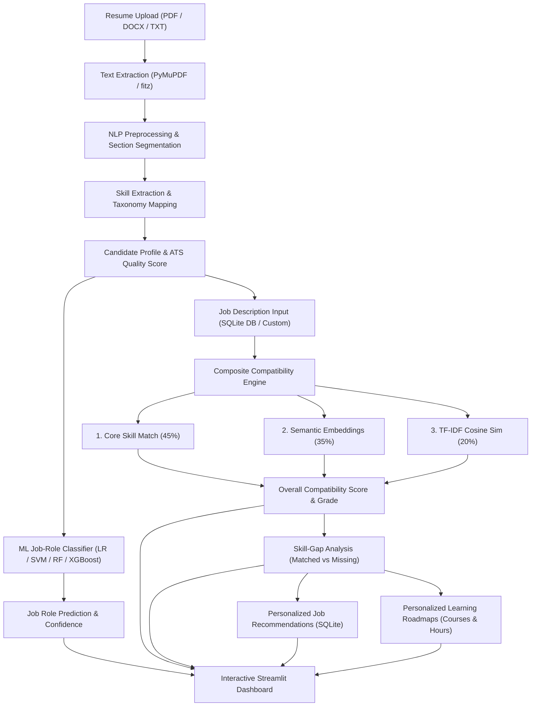

# AI-Powered Resume Analysis and Job Recommendation System
**Machine Learning [CSE_3125] Project**  
*Faculty Guide:* **Shreya Banerjee**  
*Team Members:*  
- **Tejaswini Singh** (Reg. No: 245805418)  
- **Shriya Shet** (Reg. No: 245805454)  

---

## 📌 Executive Summary & Problem Statement
Traditional recruitment screening predominantly relies on either manual human inspection or keyword-based Applicant Tracking Systems (ATS). Manual evaluation is time-intensive and prone to human inconsistency, while conventional ATS tools suffer from strict lexical rigidity—failing to comprehend the contextual semantics and synonyms of candidate skills. Furthermore, job seekers and students frequently lack clear insights into which career roles best align with their skills, what concrete skill deficiencies they possess, and how to methodically bridge those gaps.

This project delivers an end-to-end **AI Resume Analyzer & Job Recommender**: an intelligent, NLP and Machine Learning-powered system that:
1. Automatically extracts and structures textual content from PDF/DOCX/TXT resumes.
2. Identifies technical and soft competencies using a comprehensive categorized skill taxonomy.
3. Predicts best-fit job roles using an ensemble of 4 benchmarked ML classifiers (**Logistic Regression, Support Vector Machine, Random Forest, and XGBoost**).
4. Generates an explainable **Job Compatibility Score** combining direct skill matching (45%), deep semantic sentence transformer embeddings (35%), and TF-IDF cosine similarity (20%).
5. Performs actionable **Skill-Gap Analysis**, distinguishing mandatory requirements, bonus competencies, and gap severity.
6. Delivers **Personalized Career Recommendations** including ranked job matches and structured learning roadmaps with direct learning resources.
7. Offers recruiters a high-throughput **Batch Screening ATS Leaderboard**.

---

## 🏗️ System Architecture & Workflow



---

## 🛠️ Technology Stack

| Component | Technology / Library | Purpose |
| :--- | :--- | :--- |
| **Programming Language** | Python 3.11 | Core system implementation |
| **PDF Extraction** | PyMuPDF (`fitz`), `python-docx` | Robust text and metadata extraction from PDF and DOCX |
| **Natural Language Processing** | `nltk`, Regex Heuristics | Tokenization, lemmatization, stop-words, ATS quality metrics |
| **Skill Extraction** | Curated Skill Taxonomy (JSON) | 1,000+ skills across 11 technical & soft skill domains |
| **Machine Learning Classification** | `scikit-learn`, `xgboost` | Multi-class job role prediction and model comparison |
| **Models Evaluated** | Logistic Regression, SVM, Random Forest, XGBoost | Benchmarked on Accuracy, Precision, Recall, and F1-score |
| **Lexical Similarity** | TF-IDF + Cosine Similarity | Term-frequency keyword alignment |
| **Semantic Similarity** | `sentence-transformers` (`all-MiniLM-L6-v2`) | Deep contextual understanding beyond exact keywords |
| **Recommendation Engine** | Content-based Filtering | Tailored job ranking and customized course roadmaps |
| **Persistence Database** | SQLite (`resumes_database.db`) | Storing jobs, analysis history, candidate profiles |
| **Frontend Web Dashboard** | Streamlit | Responsive, multi-tab interactive UI |
| **Visual Analytics** | Plotly Express & Graph Objects | Real-time gauge charts, radar charts, and comparison bars |

---

## 🚀 Key Features

### 1. Resume Extraction & ATS Quality Heuristics
- Extracts contact details (Name, Email, Phone, LinkedIn, GitHub, Portfolio).
- Automatically segments sections: Summary, Skills, Work Experience, Education, Projects, and Certifications.
- Computes ATS Quality Score across 5 weighted dimensions: Action Verbs count, Quantifiable Metrics, Section Completeness, Skill Density, and Content Length.

### 2. Multi-Model ML Job-Role Predictor
- Predicts top-3 career matches with confidence percentages.
- Side-by-side comparison table of all 4 ML algorithms (**Logistic Regression, SVM, Random Forest, XGBoost**) evaluated on test splits.

### 3. Explainable Job Matching & Skill-Gap Matrix
- Evaluates resumes against any target job posting.
- Categorizes competencies into:
  - **Matched Core Skills** (green badges)
  - **Missing Core Skills** (red badges with urgency callout)
  - **Matched Preferred Skills** (blue badges)
  - **Missing Preferred Skills** (yellow badges)
- Computes Gap Severity Index (None, Low, Moderate, High).

### 4. Personalized Career & Learning Roadmaps
- Recommends top matching job openings from SQLite database.
- Generates curated learning paths for each missing skill, outlining platform (Coursera, Udemy, Docs), estimated study hours, and key topics.

### 5. Recruiter ATS Batch Screening
- Ranks multiple applicant resumes against a target job simultaneously on a leaderboard.

---

## 📂 Project Directory Structure

```
ai-resume-analyzer/
│
├── data/
│   ├── skills_dataset.json          # Taxonomy of 1000+ categorized skills
│   ├── job_descriptions.json        # Pre-loaded database of industry job openings
│   ├── learning_resources.json      # Curated courses and tutorials for skills
│   ├── resume_training_data.csv     # Balanced dataset for job role classification
│   └── resumes_database.db          # SQLite persistent database
│
├── models/
│   ├── job_role_classifier.pkl      # Serialized ML models + vectorizers
│   └── model_metrics.json           # Evaluation metrics for LR, SVM, RF, XGBoost
│
├── sample_resumes/                  # Instant ready-to-test sample resumes
│   ├── ml_engineer_resume.txt       # Machine Learning Engineer profile
│   ├── data_scientist_resume.txt    # Data Scientist profile
│   └── fullstack_developer_resume.txt # Full Stack Developer profile
│
├── src/
│   ├── __init__.py
│   ├── text_extractor.py           # PDF, DOCX, TXT parser & section segmenter
│   ├── nlp_processor.py            # Text cleaning, contact extraction, ATS heuristics
│   ├── skill_extractor.py          # Category-aware skill extractor & alias resolver
│   ├── ml_classifier.py            # ML model training, benchmarking & prediction
│   ├── job_matcher.py              # TF-IDF + Semantic SentenceTransformer matcher
│   ├── skill_gap_analyzer.py       # Gap severity & readiness calculation
│   ├── recommender.py              # Content-based jobs & course roadmap generator
│   └── database.py                 # SQLite database queries & persistence
│
├── train_models.py                 # Script to train and benchmark all ML models
├── app.py                          # Streamlit web application
├── requirements.txt                # Python project dependencies
├── run.bat                         # Windows 1-click batch launcher
├── run.ps1                         # PowerShell launcher
└── README.md                       # Complete documentation
```

---

## ⚡ How to Run the Project

### 1. Prerequisites
- Python 3.10 or 3.11 installed.

### 2. Activate Virtual Environment
```powershell
cd C:\Users\tejas\.gemini\antigravity\scratch\ai-resume-analyzer
.\.venv\Scripts\activate
```

### 3. (Optional) Re-train ML Models
```powershell
python train_models.py
```

### 4. Launch the Streamlit Web Application
```powershell
streamlit run app.py
```
Or simply double-click **`run.bat`**!

The web dashboard will open in your browser at `http://localhost:8501`.
# AI_Resumer_Analyser

# AI_Resumer_Analyser

